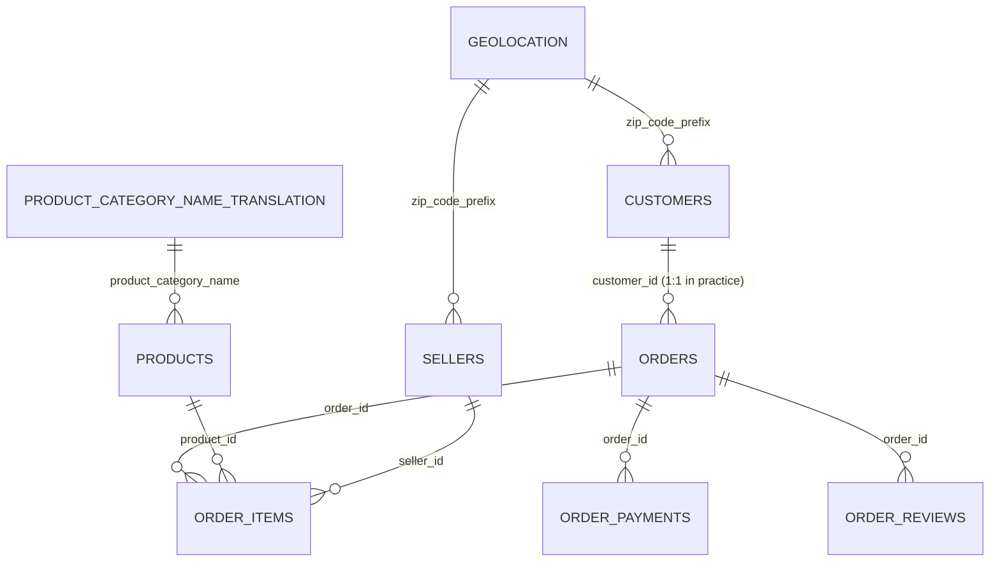
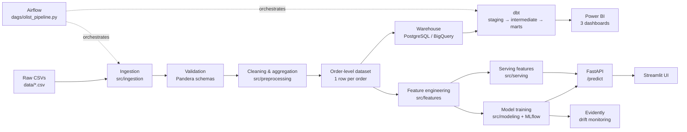
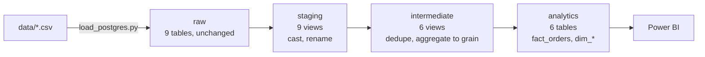

# Olist E-commerce Intelligence Platform

An end-to-end data platform built on the **Brazilian E-Commerce Public Dataset by Olist**
(~100k orders, 2016–2018, 9 relational CSVs): ingestion → warehouse → BI → delivery-delay
prediction → deployment → monitoring.

The project is built **local-first** (Docker Compose, PostgreSQL, Airflow) with GCP as an
optional deployment target. Correctness and reproducibility take priority over the number of
technologies used.

[](https://github.com/nick-st-coder/olist-intelligence/actions/workflows/ci.yml)

---

## Status

| Phase | Scope | State |
|-------|-------|-------|
| 1 | Data understanding — inventory, grain, keys, FK integrity, data dictionary, data quality | ✅ Complete — [`notebooks/01_data_understanding.ipynb`](notebooks/01_data_understanding.ipynb) |
| 2 | Exploratory data analysis — business findings | ✅ Complete — [`notebooks/02_eda.ipynb`](notebooks/02_eda.ipynb) |
| 3 | Cleaning & preprocessing — order-level dataset, Pandera schemas, tests | ✅ Complete — `src/preprocessing/`, `data/processed/orders_enriched.parquet` |
| 4 | Data engineering — Postgres + BigQuery warehouses, dbt models and tests, Airflow | ✅ Complete — both targets build 111 tests green and reconcile to identical figures |
| 5 | Business intelligence — Power BI dashboards, Excel report | ✅ Complete — `powerbi/` (PBIP: TMDL model + 3-page report), 20/20 measures validated |
| 6 | Machine learning — delivery-delay model, MLflow registry | ✅ Complete — `src/features/`, `src/modeling/`, [`notebooks/03_model_experiments.ipynb`](notebooks/03_model_experiments.ipynb) |
| 7 | Deployment — FastAPI, Streamlit, Docker, Cloud Run | ✅ Complete — `api/`, `app/`, `src/serving/`, `docker/api.Dockerfile`, `docker/app.Dockerfile` |
| 8 | Monitoring — Evidently drift, retraining workflow | ✅ Complete — simulated monthly drift, delayed-label performance, gated MLflow registration |
| 9 | CI/CD & documentation — GitHub Actions | ✅ Complete — `.github/workflows/ci.yml` (lint, test, dbt parse, image build) |

Phases 1–9 are implemented: the local Postgres warehouse, the BigQuery warehouse, the
dbt project with its tests, the Airflow DAG, the delivery-delay model, the prediction service,
the Power BI report, the simulated monitoring workflow and the CI pipeline are complete, and
the two warehouses reconcile to identical figures.

---

## Business problems

**Sales intelligence** — how does revenue evolve over time; which categories, regions and
sellers drive it; what is the average order value; how do freight costs affect performance.

**Logistics and delivery performance** — what share of orders arrive later than estimated;
which sellers and regions are slowest; does shipping distance matter; can a late order be
identified *before* it ships.

**Customer experience** — does late delivery depress review scores; which categories and
regions are least satisfied; what share of customers buy again.

---

## Dataset

[Brazilian E-Commerce Public Dataset by Olist](https://www.kaggle.com/datasets/olistbr/brazilian-ecommerce)
— 9 CSVs covering orders, order items, payments, reviews, customers, sellers, products,
geolocation and a category-name translation table.

The raw files are **not versioned**. Download them from Kaggle and place them directly in
`data/`:

```
data/
├── olist_orders_dataset.csv
├── olist_order_items_dataset.csv
├── olist_order_payments_dataset.csv
├── olist_order_reviews_dataset.csv
├── olist_customers_dataset.csv
├── olist_sellers_dataset.csv
├── olist_products_dataset.csv
├── olist_geolocation_dataset.csv
└── product_category_name_translation.csv
```

`data/` is **read-only source of truth** — nothing in this repository writes to it. Derived
artefacts belong in `data/interim/` and `data/processed/`, both gitignored.

### Data model



| Table | Rows | Grain | Primary key |
|-------|------|-------|-------------|
| `orders` | 99,441 | 1 row per order | `order_id` |
| `order_items` | 112,650 | 1 row per line item | `(order_id, order_item_id)` |
| `order_payments` | 103,886 | 1 row per payment line | `(order_id, payment_sequential)` |
| `order_reviews` | 99,224 | 1 row per review | **none** — must dedupe to 1 per order |
| `customers` | 99,441 | 1 row per order-scoped customer | `customer_id` |
| `sellers` | 3,095 | 1 row per seller | `seller_id` |
| `products` | 32,951 | 1 row per product | `product_id` |
| `geolocation` | 1,000,163 | many rows per ZIP prefix | **none** — must aggregate |
| `category_translation` | 71 | 1 row per category | `product_category_name` |

`customer_id` is **order-scoped** (1:1 with `order_id`). The person-level identity is
`customer_unique_id` — 96,096 people, of whom 2,997 bought more than once. Repeat-purchase
analysis must use `customer_unique_id`.

---

## Architecture



---

## Repository structure

```
olist-intelligence/
├── data/                     # raw CSVs (read-only) + interim/ + processed/
├── notebooks/
│   ├── 01_data_understanding.ipynb   # data inventory, grain, keys, quality
│   ├── 02_eda.ipynb                  # business findings
│   └── 03_model_experiments.ipynb    # features, model comparison, threshold, SHAP
├── src/
│   ├── ingestion/            # extract.py, load.py, load_postgres.py, load_gcp.py
│   ├── validation/           # schemas.py (Pandera)
│   ├── preprocessing/        # cleaning.py, aggregation.py, geolocation.py
│   ├── features/
│   │   ├── build_features.py # the feature contract
│   │   └── historical.py     # leakage-safe seller history
│   ├── modeling/
│   │   ├── splitting.py      # chronological splits, temporal CV
│   │   ├── preprocessing.py  # column transformer
│   │   ├── models.py         # model zoo, calibration
│   │   ├── evaluate.py       # metrics, cost-based threshold
│   │   ├── train.py          # experiment orchestration, MLflow
│   │   ├── explain.py        # SHAP, per-order contributions
│   │   ├── predict.py        # scoring, risk bands
│   │   └── __main__.py       # CLI
│   ├── serving/
│   │   ├── features.py       # request → feature frame
│   │   ├── service.py        # the prediction service, framework-independent
│   │   └── samples.py        # real orders and form options for the UI
│   └── monitoring/
│       ├── drift.py          # Evidently data-quality and feature/prediction drift
│       ├── simulation.py     # chronological batch replay and delayed labels
│       ├── performance.py   # PR-AUC/base-rate lift, confusion matrix, calibration
│       ├── retraining.py    # candidate comparison and gated MLflow registration
│       └── __main__.py      # monitoring CLI
├── dbt/models/{staging,intermediate,marts}/
├── dags/                     # Airflow DAG
├── api/                      # FastAPI: /health, /predict, /model/info, /metrics
├── app/                      # Streamlit UI
├── tests/                    # pytest
├── configs/model.yaml        # splits, cost matrix, model params, MLflow
├── docker/
│   ├── airflow.Dockerfile
│   ├── api.Dockerfile        # serving group only
│   └── app.Dockerfile        # serving group only
├── docker-compose.yml
└── pyproject.toml            # single source of config (uv, ruff, pytest)
```

---

## Data warehouse

The raw CSVs are loaded unchanged into a local Postgres `raw` schema, then transformed by dbt
into a star schema. The warehouse is a second consumer of the same source data as the ML
pipeline — it does not feed the model, and the model does not feed it.



### Running it

```bash
docker compose up -d postgres
uv run python -m src.ingestion.load_postgres
DBT_PROFILES_DIR=./dbt uv run dbt build --project-dir dbt
```

`dbt build` runs 21 models and 90 tests. The load is idempotent — every table is replaced, so
re-running produces the same database state.

### Orchestration

`dags/olist_pipeline.py` runs the pipeline as a graph with two destinations:

```
extract → validate ─┬─→ load_raw ────────→ dbt_build_local   (Postgres)
                    └─→ upload_to_gcs → load_to_bigquery → dbt_build_bq   (BigQuery)
```

`extract` reads the nine CSVs and returns their row counts; `validate` fails the run if any
count differs from the verified figures, so a truncated source file never reaches either
warehouse. The cloud branch is enabled with `OLIST_CLOUD_ENABLED=true`; the local branch always
runs, so the DAG works with or without a GCP account.

```bash
docker compose up -d airflow          # UI on http://localhost:8081 (admin / admin)
docker exec olist-airflow bash -c "airflow dags test olist_pipeline 2026-11-04"
```

The DAG is idempotent: running it twice leaves both warehouses in the same state. That second
run is the real test, because a loader that only works once will fail on every Airflow retry.

Two container settings are load-bearing and easy to miss:

- **`shm_size: 256mb`** on Postgres. Docker's default 64 MB `/dev/shm` is too small for the
  parallel workers `fact_orders` spawns, and the build fails with `could not resize shared
  memory segment ... No space left on device`.
- **`pyproject.toml` mounted into the Airflow container.** `src.config` locates the project
  root by requiring `data/` and `pyproject.toml` side by side.

The Airflow image installs dbt **outside** Airflow's constraints file, because those
constraints pin dbt to 1.8 while the project's YAML uses the `arguments` test syntax added in
1.10. SQLAlchemy is reinstalled at `<2` afterwards to keep Airflow's ORM working.

### Cloud target

The same 21 models build against BigQuery with `--target bq`. Only the profile changes; the
SQL is shared. Six constructs needed a portable form:

| Postgres | Portable form | Why |
|---|---|---|
| `date_part('day', a - b)` | `dbt.datediff(a, b, 'day')` | BigQuery cannot subtract timestamps |
| `generate_series(...)` | `dbt.date_spine(...)` | Postgres-only function |
| `numeric(12, 2)` | `dbt.type_numeric()` | BigQuery rejects parameterised casts |
| `percentile_cont(0.5) within group` | `row_number()` window | BigQuery has no ordered-set aggregates |
| `mode() within group` | `row_number()` over a count | same |
| `count(*) filter (where ...)` | `sum(case when ... then 1 else 0 end)` | BigQuery has no `FILTER` |

Two further differences are not syntax but semantics:

- **`accepted_values` on an integer column** needs `quote: false`. The default quotes values as
  strings, which Postgres coerces and BigQuery rejects.
- **`day_of_week`** is normalised to 0 = Monday in `dim_date`, because Postgres' `isodow` is
  1 = Monday while BigQuery's `dayofweek` is 1 = Sunday.

Both warehouses produce identical figures:

| Metric | Postgres | BigQuery |
|--------|----------|----------|
| rows | 99,441 | 99,441 |
| label-eligible | 96,470 | 96,470 |
| late | 7,826 | 7,826 |
| late rate | 8.11% | 8.11% |

Authentication uses Application Default Credentials rather than a service-account keyfile,
because the project enforces `constraints/iam.disableServiceAccountKeyCreation`.

### Models

| Layer | Materialization | Models |
|-------|-----------------|--------|
| Staging | view | `stg_orders`, `stg_customers`, `stg_sellers`, `stg_products`, `stg_order_items`, `stg_order_payments`, `stg_order_reviews`, `stg_geolocation`, `stg_category_translation` |
| Intermediate | view | `int_order_items_aggregated`, `int_payments_aggregated`, `int_reviews_deduplicated`, `int_geolocation_by_zip`, `int_order_delivery`, `int_primary_item` |
| Marts | table | `fact_orders`, `fact_order_items`, `dim_customers`, `dim_products`, `dim_sellers`, `dim_date` |

Staging does not filter, join or aggregate — it only casts types and corrects the source
column-name typos. The intermediate layer is where every one-to-many table is collapsed to
order grain, so the marts can join safely.

### Reconciliation

`fact_orders` must reproduce the order-level dataset exactly. Both paths are built from the
same nine CSVs by different code, so agreement is evidence that neither has a join or
deduplication bug.

| Metric | `fact_orders` (SQL) | `orders_enriched.parquet` (pandas) |
|--------|--------------------|-----------------------------------|
| rows | 99,441 | 99,441 |
| label-eligible | 96,470 | 96,470 |
| late | 7,826 | 7,826 |
| late rate | 8.11% | 8.11% |

### Business-logic tests

Beyond the generic `unique` / `not_null` / `relationships` / `accepted_values` tests, six
singular tests encode rules that a schema cannot express:

| Test | Catches |
|------|---------|
| `assert_fact_orders_row_count` | a join that multiplied or dropped order rows |
| `assert_eligible_order_count` | a change to the label-eligibility rule |
| `assert_late_rate_in_range` | a broken label definition (rate must stay 7–9%) |
| `assert_label_null_iff_ineligible` | `is_late` set to FALSE instead of NULL |
| `assert_late_label_matches_timestamps` | a label that disagrees with the raw timestamps |
| `assert_orders_without_items_preserved` | an INNER JOIN dropping the 775 orders with no line items |

---

## Phase 1 findings

All figures below are computed in `notebooks/01_data_understanding.ipynb`.

**Label eligibility.** 96,470 of 99,441 orders (97.01%) can carry a delivery-delay label
(`order_status == 'delivered'` with both delivery dates present). 7,826 are late (8.11%),
giving an imbalance of roughly **1 : 11.3**. PR-AUC and a tuned decision threshold are
therefore mandatory; accuracy would be misleading at this base rate.

**Referential integrity is clean.** All six transactional foreign keys resolve with zero
orphans. The only unresolved references are soft lookups: 278 customer and 7 seller ZIP
prefixes absent from `geolocation`, and 2 categories absent from the translation table.
Coverage gaps (775 orders without items, 1 without payment, 768 without review) mean the
order-level build must use `LEFT JOIN`.

**Five defects constrain the work ahead:**

| # | Issue | Measured impact |
|---|-------|-----------------|
| 1 | `order_estimated_delivery_date` is date-only (100% at `00:00:00`) | 1,292 orders delivered *on* the estimate day count as late — 16.5% of all positives. End-of-day reading moves the late rate 8.11% → 6.77% |
| 2 | `order_reviews` is not 1:1 with orders | 547 orders have >1 review; 814 rows reuse a `review_id`. A naive join multiplies order rows |
| 3 | `geolocation` is a sample, not a lookup | 93.5% of the 19,015 prefixes hold more than one distinct coordinate; only 1,234 are unambiguous |
| 4 | Missing delivery dates | 2,965 nulls, including 8 orders marked `delivered` with no timestamp |
| 5 | Unusable temporal tails | 329 orders in 2016 (0.33%); only 20 in Sep–Oct 2018 vs ~6,300/month |

Also documented: 166 orders show carrier handover before purchase and 23 show delivery before
handover (purchase → approved and purchase → delivered are clean, so the prediction timestamp
is trustworthy); 610 products (1.85%) have their entire metadata block null; 383 zero-freight
lines; 9 zero-value payment lines; 40,977 reviews contain text vs 58,247 without, and the
commenting segment is heavily biased (mean score 3.67 vs 4.38).

---

## Machine learning task

**Delivery delay prediction** — binary classification: will an order arrive later than its
estimated delivery date?

```
is_late = 1 if order_delivered_customer_date > order_estimated_delivery_date else 0
```

**Prediction timestamp = `order_purchase_timestamp`.** Every feature must be knowable at that
instant.

**Candidate features** — purchase hour, day of week, month, item count, order value, freight
value, seller count, product count; product category, weight and dimensions; customer and
seller state, approximate shipping distance; leakage-safe historical seller statistics
(prior order volume, prior late rate) computed with expanding windows shifted by one order.

**Forbidden (leakage)** — actual delivery date, carrier handover date, delivery duration,
review score and comments, order status, and any aggregate computed over the full dataset.

**Development ladder** — `DummyClassifier` → Logistic Regression → Random Forest → LightGBM →
XGBoost → Optuna tuning → temporal cross-validation → threshold optimisation → SHAP.

**Evaluation** — Precision, Recall, F1, ROC-AUC, PR-AUC, confusion matrix and a business
cost-benefit analysis. **Chronological splits only**; never `train_test_split(random_state=...)`.

---

## Delivery-delay model

### The label measures a promise, not a delivery time

`is_late` compares the actual delivery against `order_estimated_delivery_date`, and that estimate
is generated by a process the dataset does not expose. The monthly late rate swings between
**1.36% (Jun 2018)** and **21.36% (Mar 2018)** with no corresponding change in delivery
performance — the *estimate* moved, not the logistics. This sets a ceiling on what any
purchase-time model can achieve, and it is the single most important fact about this task.

### Splits

Three contiguous windows of purchase dates, no shuffling:

| Partition | Window | Orders | Late | Late rate |
|-----------|--------|--------|------|-----------|
| Train | 2017-01-05 → 2018-03-31 | 64,053 | 5,886 | 9.19% |
| Validation | 2018-04-01 → 2018-05-31 | 13,547 | 917 | 6.77% |
| Test | 2018-06-01 → 2018-08-29 | 18,603 | 1,019 | 5.48% |

2016 is excluded (329 orders in total) and the window ends in August 2018 (Sep–Oct hold 20
orders between them). Hyperparameters are searched on four expanding-window folds **inside** the
training window, with a 30-day purge gap at each boundary so a fold never sees a label that
arrived after it started.

### Seller history without looking ahead

A seller's past delivery record is the most useful feature and the easiest one to leak. The
subtlety is *when* a past order becomes knowledge: not when it was purchased, but when it was
delivered. An order placed in January and delivered in March tells you nothing in February.

The features therefore merge on the **completion** timeline — for each order they summarise the
seller's orders that had already been delivered before it was placed. That definition is
invariant to the future: adding or relabelling later orders cannot change an earlier order's
features, which `tests/test_historical.py` asserts directly. 94.5% of orders have at least one
completed prior order by the same seller.

The signal is a gradient rather than a rule. Grouping orders by the seller's prior late rate, the
observed late rate rises from **6.6%** for sellers whose completed orders were almost never late
to **11.1%** for the worst group — but the 0.10–0.20 bucket dips to 8.6% instead of continuing
upward. That is exactly the kind of noisy-but-real signal a model should be given, and exactly
why it should not be read as a per-seller verdict.

### Results

Each model is scored on validation at **its own cost-optimal threshold**, because a class-weighted
model and a calibrated one put their useful operating point in different places. PR-AUC and
ROC-AUC are threshold-free.

| Model | PR-AUC | ROC-AUC | Precision | Recall | Cost / order |
|-------|--------|---------|-----------|--------|--------------|
| Dummy (prior) | 0.068 | 0.500 | 0.000 | 0.000 | 0.677 |
| Logistic regression | **0.184** | **0.751** | 0.173 | 0.551 | **0.482** |
| Random forest | 0.145 | 0.694 | 0.134 | 0.522 | 0.551 |
| LightGBM | 0.174 | 0.684 | 0.137 | 0.466 | 0.559 |
| XGBoost | 0.175 | 0.689 | 0.141 | 0.463 | 0.554 |

The regularised linear model wins. That is not an accident of tuning: the signal is close to
additive — a longer estimated lead time, a cross-state route, a distant seller, a state with poor
infrastructure — and a linear model in a one-hot space represents exactly that. The ensembles
have the capacity to memorise the 2017-11 and 2018-03 spikes, and they do, at the cost of
generalisation. Optuna tuning on temporal folds did not close the gap.

**Test window** (scored once, threshold frozen from validation): PR-AUC **0.099**, ROC-AUC
**0.688**, precision 0.099, recall 0.469, cost per order 0.52. The test late rate is 5.5% against
the 9.2% the model was trained on, so the absolute numbers are worse than validation by
construction.

### Threshold and calibration

Class weighting is what makes an 8% positive rate learnable, but it inflates every probability by
roughly the inverse of that rate — the balanced model's mean prediction was **0.502** against an
actual late rate of **0.068**. Every estimator is therefore wrapped in isotonic calibration fitted
inside the training window, which restores a probability that can be read as a probability. The
cost-optimal threshold moved from 0.62 to 0.15 as a result.

The threshold itself is chosen on validation by minimising an explicit cost matrix: a missed late
order costs ten times an unnecessary alarm. It is not a property of the model — it is a statement
about the business, and the sensitivity table in the notebook shows how it moves if that ratio
changes.

### What drives the predictions

SHAP contributions, grouped back from the one-hot columns to the source features:

| Feature | Share of total absolute SHAP |
|---------|------------------------------|
| `estimated_lead_days` | 19.6% |
| `customer_state` | 18.7% |
| `is_cross_state` | 11.4% |
| `seller_state` | 10.5% |
| `seller_customer_distance_km` | 7.8% |
| `product_category` | 7.7% |
| `seller_prior_mean_delivery_days` | 7.7% |
| `seller_prior_orders` | 4.4% |

The estimated lead time is the largest single driver, which is the right answer: it is the promise
the order is measured against, and a generous estimate is easy to beat. Geography follows, then
the seller's own delivery record. All of it is known at checkout.

The categorical blocks are split across many one-hot columns, so a state's contribution is spread
over 27 columns while a numeric feature is a single column. Summing the group is the right way to
compare them, which is what the table does.

### Running it

```bash
# full experiment: five models, Optuna tuning, MLflow tracking and registry
uv run python -m src.modeling train

# one Optuna trial per tuned model, no tracking — for a quick check
uv run python -m src.modeling train --fast --no-tracking

# global SHAP importance for the saved pipeline
uv run python -m src.modeling explain

# score the test window with the saved pipeline and its frozen threshold
uv run python -m src.modeling score
```

The fitted pipeline is written to `data/processed/modeling/delivery_delay_pipeline.joblib` with a
`.json` sidecar carrying the threshold, the test metrics and the split boundaries — a probability
is not a decision, so the threshold travels with the artefact. Runs are logged to `mlflow.db` and
the best model is registered as `olist-delivery-delay`.

### Reading the result honestly

A PR-AUC of 0.099 against a 0.055 base rate means the model concentrates late orders about 1.8
times better than chance. That supports **ranking** orders by risk — at the chosen threshold it
catches roughly half the late orders while flagging a fifth of the book, enough to prioritise a
support queue. It does not support per-order certainty: a 0.15 probability is not "this will be
late", it is "orders like this are late about three times as often as the average order".

---

## Prediction service

An order is scored through an HTTP API. The service loads the artefact and its scoring contract
once at start-up and serves four endpoints.

| Endpoint | Returns |
|----------|---------|
| `GET /health` | whether the artefact is loaded, the model version, whether explanations are available |
| `POST /predict` | delay probability, binary decision, risk band, model version per order |
| `GET /model/info` | model name, threshold, target definition, split boundaries, test metrics |
| `GET /metrics` | in-process request, order and latency counters |

```bash
uv run uvicorn api.main:app --port 8000
```

`POST /predict` accepts up to 500 orders in one call:

```json
{
  "orders": [
    {
      "order_purchase_timestamp": "2018-03-01T09:00:00",
      "order_estimated_delivery_date": "2018-04-15",
      "customer_state": "BA",
      "seller_state": "SP",
      "n_items": 1,
      "item_revenue": 129.9,
      "freight_value": 22.4,
      "payment_value": 152.3
    }
  ],
  "explain": true
}
```

```json
{
  "predictions": [
    {
      "delay_probability": 0.1367,
      "predicted_late": false,
      "risk_band": "medium",
      "model_name": "logistic_regression",
      "model_version": "240c39f61d1b",
      "threshold": 0.15,
      "increases_risk": [{ "feature": "estimated_lead_days", "shap_value": 0.7788 }],
      "decreases_risk": [{ "feature": "is_cross_state", "shap_value": -0.4745 }]
    }
  ],
  "flagged": 0,
  "model_version": "240c39f61d1b",
  "threshold": 0.15
}
```

Only the purchase timestamp and the promised delivery date are mandatory. Everything else is
optional and imputed with the training median, which is why a partial checkout payload still
scores.

### The contract refuses post-purchase fields

The request schema forbids unknown fields, so a caller cannot quietly send
`order_delivered_customer_date` and have it ignored — the request is rejected with a 422 that
names the field. This is deliberate: the field is the label, and a service that silently accepted
it would be one refactor away from using it.

There is a test for the same property from the other direction. Supplying the actual delivery
date, the status and a review score alongside a valid payload leaves every predicted probability
identical, because nothing in the serving path reads those columns.

### One feature path, not two

The most likely way a deployed model goes wrong is silently diverging from its training
preprocessing: the service derives a feature slightly differently, the model sees a distribution
it never fitted, and the predictions degrade without any error being raised.

The service therefore does not re-implement the derivations. It calls the same
`add_purchase_time_features` and `haversine_km` functions the batch pipeline uses, and
`tests/test_serving.py` asserts that the same orders produce identical feature frames down both
paths — every column, one at a time.

### Seller history at serving time

The seller history features need a completion timeline built from every delivered order in the
dataset. That build costs about half a second and nothing in it changes between requests, so it
happens once at start-up. A new order then attaches the seller's record as of the instant it was
placed, through the same as-of merge the training code uses.

Without the dataset the service still runs: the history columns fall back to their imputed values
and `seller_has_history` is false. Losing the data degrades the features, it does not take the
service down.

### Explanations

`explain=true` adds the factors that moved each score. Contributions are SHAP values in
log-odds, grouped from the one-hot columns back onto the source feature, so the answer names
`customer_state` rather than `customer_state_SP`.

An explanation of a single order needs a **reference distribution** to compare against. Passing
the row being explained as its own baseline produces Shapley values of exactly zero, because
nothing deviates from itself — a failure that is silent, since a table of zeros looks like a
weak-but-valid answer. The service instead samples 2,000 rows of delivered history as the
baseline and asserts additivity: the contributions plus the base value must reconstruct the
model's decision function for that order.

Explaining costs roughly 100 ms per order, so it is opt-in rather than the default.

### Interface

```bash
uv run streamlit run app/streamlit_app.py
```

The dashboard builds an order from a form — purchase date, promised lead time, route states,
basket — posts it to the API and shows the probability, the risk band and the two contribution
tables. Real orders from the dataset can be loaded into the form as a starting point.

It talks HTTP rather than importing the model, so it demonstrates the same contract an external
caller uses and can be pointed at a deployment with the `API_URL` environment variable.

---

## Monitoring

The source dataset is static and historical, so monitoring is an explicitly **simulated
replay**, not production telemetry. The workflow compares monthly batches from June–August 2018
with the model's training-period reference. Each Evidently report includes feature and prediction
drift, data quality, missing/invalid values and newly observed categories.

```bash
# Install the optional monitoring and candidate-training dependencies
uv sync --group monitoring

# Replay monthly batches and create Evidently HTML/JSON plus delayed-label metrics
uv run python -m src.monitoring run

# Fit a candidate using data before the holdout; register only if it clears the PR-AUC gate
uv run python -m src.monitoring retrain
```

Reports are written under `data/processed/monitoring/`: `latest-run.json` links to per-month
`drift.html`, Evidently JSON, drift summaries and performance summaries. Labels become available
30 days after the recorded delivery date; each cycle reports performance only on outcomes that
would have arrived by then. PR-AUC is shown with the observed late-rate baseline and its lift,
because the label captures the promise date (not logistics performance) and its base rate changes
substantially over time.

The retraining command fits the current model family on all labelled data before the holdout,
then compares production and candidate PR-AUC on the same chronological replay window. It does
not tune on that holdout. Only a candidate that meets `min_pr_auc_lift` in
`configs/monitoring.yaml` is registered in the local MLflow registry; a rejected candidate leaves
the production artefact unchanged. All outputs remain labelled simulated.

### Containers

```bash
# API and interface, alongside the existing Postgres and Airflow services
docker compose up --build api app
```

`api` serves on port 8000 and `app` on 8501. The image installs the `serving` dependency group
only — the training stack (LightGBM, XGBoost, Optuna, MLflow) and the cloud clients are not
needed to score an order. The model artefact and the analytical dataset are mounted at runtime
rather than baked in, so retraining does not require a rebuild.

Both services declare health checks. `app` waits for `api` to report healthy before starting, and
`api` reports `degraded` from `/health` — with a 503 from `/predict` — if its artefact is missing,
rather than failing on the first request.

---

## Continuous integration

Every push to `main` and every pull request runs `.github/workflows/ci.yml`, which checks the
four things that would otherwise fail silently:

| Job | What it runs | Catches |
|-----|--------------|---------|
| `lint` | `uv run ruff check .` | style, unused imports, import order |
| `test` | `uv run pytest` then `uv lock --check` | regressions and a lockfile that drifted from `pyproject.toml` |
| `dbt` | `uv run dbt parse --project-dir dbt` | a dbt project that no longer compiles |
| `docker` | builds `docker/api.Dockerfile` and `docker/app.Dockerfile` | a Dockerfile that no longer builds |

The test job needs no data or model artefact: the API and serving tests skip cleanly when the
artefact is absent, the cleaning, feature and model tests skip when the raw CSVs are absent, and
the monitoring tests use synthetic frames. The dbt job validates the project offline with
`dbt parse` against a profiles file generated from `dbt/profiles.yml.example`, so it needs no
database. The image builds are the only job that requires Docker, and they run on GitHub's
hosted runners.

The project is deliberately **local-first**, so there is no deploy step: the images are built to
prove they compile, not pushed to a registry. Cloud Run was considered and set aside — the
platform runs locally via Docker Compose, and a deployment target can be added later without
changing the pipeline.

---

## Tech stack

| Area | Tools |
|------|-------|
| Analysis | Python 3.11+, pandas, NumPy, matplotlib, seaborn |
| Data engineering | Airflow, dbt, PostgreSQL, Pandera |
| Cloud (optional) | GCS, BigQuery, Cloud Run, Artifact Registry |
| Business intelligence | Power BI, Excel, Power Query, DAX |
| Machine learning | scikit-learn, LightGBM, XGBoost, Optuna, SHAP |
| MLOps | MLflow, Evidently, FastAPI, Docker, GitHub Actions, pytest |
| Application | Streamlit |
| Dev tools | uv, ruff, Git, Jupyter |

---

## Getting started

Requires **Python 3.11+** and [uv](https://docs.astral.sh/uv/).

```bash
git clone https://github.com/nick-st-coder/olist-intelligence.git
cd olist-intelligence

# install dependencies (creates .venv)
uv sync --all-groups

# download the 9 CSVs from Kaggle into data/ (see Dataset above)

# run the tests
uv run pytest

# lint and format
uv run ruff check .
uv run ruff format .
```

To serve predictions, the model must exist first — `uv run python -m src.modeling train` writes
the artefact the service loads. The two web services then start independently:

```bash
uv run uvicorn api.main:app --port 8000     # prediction API
uv run streamlit run app/streamlit_app.py   # interface, expects API_URL
```

To run the Phase 1 notebook, open `notebooks/01_data_understanding.ipynb` and select the
`olist-intelligence` kernel. The notebook resolves the project root by walking upwards from
its own location until it finds `data/` and `pyproject.toml`, so it runs identically from any
working directory.

---

## Conventions

- **One row per order** in the analytical and ML datasets. `order_items` and `order_payments`
  are aggregated **separately** before joining to `orders` — never joined raw.
- **Notebooks explore, `src/` produces.** Any logic used twice moves into `src/` with a test.
- **Validate at boundaries** with Pandera schemas before data enters the warehouse or model.
- **Chronological splits only** for the delivery model.
- **Secrets never in Git** — `.env` (gitignored) plus `.env.example`.
- **Local before cloud** — everything runs via Docker Compose; GCP is optional.
- Paths resolve from a single project-root constant, never from the current working directory.

---

## Limitations

- The dataset is **historical and static** (2016-09 → 2018-10). Monitoring and retraining use
  **simulated** incoming batches and delayed labels, and are labelled as simulated.
- The observation window is not uniformly dense: 2016 and Sep–Oct 2018 are too thin for
  training, so chronological splits run **2017-01 → 2018-08**.
- `geolocation` is a sample of observed coordinates, so any distance feature is an
  approximation based on one representative point per ZIP prefix.
- The late-delivery label compares against a **date-only** estimate, so a delivery on the
  estimated day counts as late. That reclassifies 1,292 orders and gives a late rate of 8.11%
  rather than 6.77%. The end-of-day reading is kept as a sensitivity check, not as the label.
- The label measures a **promise**, not a delivery time, and the process that sets the estimate
  is not in the data. This caps what the model can achieve — see *Reading the result honestly*.
- The service scores one order at a time and holds the model in process memory. A multi-instance
  deployment would need the artefact in a shared registry rather than on a mounted volume.

---

## Attribution

Dataset: *Brazilian E-Commerce Public Dataset by Olist*, published on Kaggle by Olist under
CC BY-NC-SA 4.0. All analysis in this repository is independent work built on that data.
