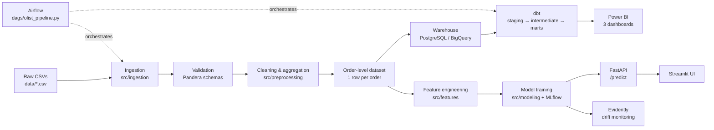
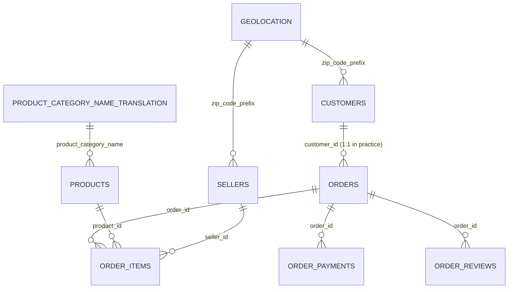

# Olist E-commerce Intelligence Platform

An end-to-end data platform built on the **Brazilian E-Commerce Public Dataset by Olist**
(~100k orders, 2016–2018, 9 relational CSVs): ingestion → warehouse → BI → delivery-delay
prediction → deployment → monitoring.

The project is built **local-first** (Docker Compose, PostgreSQL, Airflow) with GCP as an
optional deployment target. Correctness and reproducibility take priority over the number of
technologies used.

---

## Status

| Phase | Scope | State |
|-------|-------|-------|
| 1 | Data understanding — inventory, grain, keys, FK integrity, data dictionary, data quality | ✅ Complete — [`notebooks/01_data_understanding.ipynb`](notebooks/01_data_understanding.ipynb) |
| 2 | Exploratory data analysis — business findings | ⬜ Next |
| 3 | Cleaning & preprocessing — order-level dataset, Pandera schemas, tests | ⬜ Planned |
| 4 | Data engineering — GCS/BigQuery, dbt, Airflow | ⬜ Planned |
| 5 | Business intelligence — Power BI dashboards, Excel report | ⬜ Planned |
| 6 | Machine learning — delivery-delay model, MLflow registry | ⬜ Planned |
| 7 | Deployment — FastAPI, Streamlit, Docker, Cloud Run | ⬜ Planned |
| 8 | Monitoring — Evidently drift, retraining workflow | ⬜ Planned |
| 9 | CI/CD & documentation — GitHub Actions | ⬜ Planned |

Only Phase 1 is implemented. The `src/`, `dbt/`, `dags/`, `api/`, `app/` and `tests/` trees
exist as scaffolding; their modules are empty placeholders. This README is updated as each
phase lands.

---

## Business problems

**Sales intelligence** — how does revenue evolve over time; which categories, regions and
sellers drive it; what is the average order value; how do freight costs affect performance.

**Logistics and delivery performance** — what share of orders arrive later than estimated;
which sellers and regions are slowest; does shipping distance matter; can a late order be
identified *before* it ships.

**Customer experience** — does late delivery depress review scores; which categories and
regions are least satisfied; what share of customers buy again.

---

## Dataset

[Brazilian E-Commerce Public Dataset by Olist](https://www.kaggle.com/datasets/olistbr/brazilian-ecommerce)
— 9 CSVs covering orders, order items, payments, reviews, customers, sellers, products,
geolocation and a category-name translation table.

The raw files are **not versioned**. Download them from Kaggle and place them directly in
`data/`:

```
data/
├── olist_orders_dataset.csv
├── olist_order_items_dataset.csv
├── olist_order_payments_dataset.csv
├── olist_order_reviews_dataset.csv
├── olist_customers_dataset.csv
├── olist_sellers_dataset.csv
├── olist_products_dataset.csv
├── olist_geolocation_dataset.csv
└── product_category_name_translation.csv
```

`data/` is **read-only source of truth** — nothing in this repository writes to it. Derived
artefacts belong in `data/interim/` and `data/processed/`, both gitignored.

---

## Architecture



---

## Repository structure

```
olist-intelligence/
├── data/                     # raw CSVs (read-only) + interim/ + processed/
├── notebooks/
│   ├── 01_data_understanding.ipynb   # Phase 1 — complete
│   ├── 02_eda.ipynb                  # Phase 2
│   ├── 03_feature_engineering.ipynb  # Phase 6
│   └── 04_model_experiments.ipynb    # Phase 6
├── src/
│   ├── ingestion/            # extract.py, load.py
│   ├── validation/           # schemas.py (Pandera)
│   ├── preprocessing/        # cleaning.py, aggregation.py
│   ├── features/             # build_features.py
│   ├── modeling/             # train.py, evaluate.py, predict.py
│   └── monitoring/           # drift.py
├── dbt/models/{staging,intermediate,marts}/
├── dags/                     # Airflow DAG
├── api/                      # FastAPI service
├── app/                      # Streamlit UI
├── tests/                    # pytest
├── configs/                  # YAML configuration
├── docker/                   # Dockerfiles
├── docker-compose.yml
└── pyproject.toml            # single source of config (uv, ruff, pytest)
```

---

## Data model



| Table | Rows | Grain | Primary key |
|-------|------|-------|-------------|
| `orders` | 99,441 | 1 row per order | `order_id` |
| `order_items` | 112,650 | 1 row per line item | `(order_id, order_item_id)` |
| `order_payments` | 103,886 | 1 row per payment line | `(order_id, payment_sequential)` |
| `order_reviews` | 99,224 | 1 row per review | **none** — must dedupe to 1 per order |
| `customers` | 99,441 | 1 row per order-scoped customer | `customer_id` |
| `sellers` | 3,095 | 1 row per seller | `seller_id` |
| `products` | 32,951 | 1 row per product | `product_id` |
| `geolocation` | 1,000,163 | many rows per ZIP prefix | **none** — must aggregate |
| `category_translation` | 71 | 1 row per category | `product_category_name` |

`customer_id` is **order-scoped** (1:1 with `order_id`). The person-level identity is
`customer_unique_id` — 96,096 people, of whom 2,997 bought more than once. Repeat-purchase
analysis must use `customer_unique_id`.

---

## Phase 1 findings

All figures below are computed in `notebooks/01_data_understanding.ipynb`.

**Label eligibility.** 96,470 of 99,441 orders (97.01%) can carry a delivery-delay label
(`order_status == 'delivered'` with both delivery dates present). 7,826 are late (8.11%),
giving an imbalance of roughly **1 : 11.3**. PR-AUC and a tuned decision threshold are
therefore mandatory; accuracy would be misleading at this base rate.

**Referential integrity is clean.** All six transactional foreign keys resolve with zero
orphans. The only unresolved references are soft lookups: 278 customer and 7 seller ZIP
prefixes absent from `geolocation`, and 2 categories absent from the translation table.
Coverage gaps (775 orders without items, 1 without payment, 768 without review) mean the
order-level build must use `LEFT JOIN`.

**Five defects constrain the work ahead:**

| # | Issue | Measured impact |
|---|-------|-----------------|
| 1 | `order_estimated_delivery_date` is date-only (100% at `00:00:00`) | 1,292 orders delivered *on* the estimate day count as late — 16.5% of all positives. End-of-day reading moves the late rate 8.11% → 6.77% |
| 2 | `order_reviews` is not 1:1 with orders | 547 orders have >1 review; 814 rows reuse a `review_id`. A naive join multiplies order rows |
| 3 | `geolocation` is a sample, not a lookup | 93.5% of the 19,015 prefixes hold more than one distinct coordinate; only 1,234 are unambiguous |
| 4 | Missing delivery dates | 2,965 nulls, including 8 orders marked `delivered` with no timestamp |
| 5 | Unusable temporal tails | 329 orders in 2016 (0.33%); only 20 in Sep–Oct 2018 vs ~6,300/month |

Also documented: 166 orders show carrier handover before purchase and 23 show delivery before
handover (purchase → approved and purchase → delivered are clean, so the prediction timestamp
is trustworthy); 610 products (1.85%) have their entire metadata block null; 383 zero-freight
lines; 9 zero-value payment lines; 40,977 reviews contain text vs 58,247 without, and the
commenting segment is heavily biased (mean score 3.67 vs 4.38).

---

## Machine learning task

**Delivery delay prediction** — binary classification: will an order arrive later than its
estimated delivery date?

```
is_late = 1 if order_delivered_customer_date > order_estimated_delivery_date else 0
```

**Prediction timestamp = `order_purchase_timestamp`.** Every feature must be knowable at that
instant.

**Candidate features** — purchase hour, day of week, month, item count, order value, freight
value, seller count, product count; product category, weight and dimensions; customer and
seller state, approximate shipping distance; leakage-safe historical seller statistics
(prior order volume, prior late rate) computed with expanding windows shifted by one order.

**Forbidden (leakage)** — actual delivery date, carrier handover date, delivery duration,
review score and comments, order status, and any aggregate computed over the full dataset.

**Development ladder** — `DummyClassifier` → Logistic Regression → Random Forest → LightGBM →
XGBoost → Optuna tuning → temporal cross-validation → threshold optimisation → SHAP.

**Evaluation** — Precision, Recall, F1, ROC-AUC, PR-AUC, confusion matrix and a business
cost-benefit analysis. **Chronological splits only**; never `train_test_split(random_state=...)`.

---

## Tech stack

| Area | Tools |
|------|-------|
| Analysis | Python 3.11+, pandas, NumPy, matplotlib, seaborn |
| Data engineering | Airflow, dbt, PostgreSQL, Pandera |
| Cloud (optional) | GCS, BigQuery, Cloud Run, Artifact Registry |
| Business intelligence | Power BI, Excel, Power Query, DAX |
| Machine learning | scikit-learn, LightGBM, XGBoost, Optuna, SHAP |
| MLOps | MLflow, Evidently, FastAPI, Docker, GitHub Actions, pytest |
| Application | Streamlit |
| Dev tools | uv, ruff, Git, Jupyter |

---

## Getting started

Requires **Python 3.11+** and [uv](https://docs.astral.sh/uv/).

```bash
git clone https://github.com/nick-st-coder/olist-intelligence.git
cd olist-intelligence

# install dependencies (creates .venv)
uv sync

# download the 9 CSVs from Kaggle into data/ (see Dataset above)

# run the tests
uv run pytest

# lint and format
uv run ruff check .
uv run ruff format .
```

To run the Phase 1 notebook, open `notebooks/01_data_understanding.ipynb` and select the
`olist-intelligence` kernel. The notebook resolves the project root by walking upwards from
its own location until it finds `data/` and `pyproject.toml`, so it runs identically from any
working directory.

---

## Conventions

- **One row per order** in the analytical and ML datasets. `order_items` and `order_payments`
  are aggregated **separately** before joining to `orders` — never joined raw.
- **Notebooks explore, `src/` produces.** Any logic used twice moves into `src/` with a test.
- **Validate at boundaries** with Pandera schemas before data enters the warehouse or model.
- **Chronological splits only** for the delivery model.
- **Secrets never in Git** — `.env` (gitignored) plus `.env.example`.
- **Local before cloud** — everything runs via Docker Compose; GCP is optional.
- Paths resolve from a single project-root constant, never from the current working directory.

---

## Limitations

- The dataset is **historical and static** (2016-09 → 2018-10). Monitoring and retraining in
  Phase 8 use **simulated** incoming batches and delayed labels, and are labelled as simulated.
- The observation window is not uniformly dense: 2016 and Sep–Oct 2018 are too thin for
  training, so chronological splits will run **2017-01 → 2018-08**.
- `geolocation` is a sample of observed coordinates, so any distance feature is an
  approximation based on one representative point per ZIP prefix.
- The late-delivery label is sensitive to the date-only estimate (see Phase 1 findings #1).
  The chosen convention will be documented here once Phase 3 fixes it.

---

## Attribution

Dataset: *Brazilian E-Commerce Public Dataset by Olist*, published on Kaggle by Olist under
CC BY-NC-SA 4.0. All analysis in this repository is independent work built on that data.
